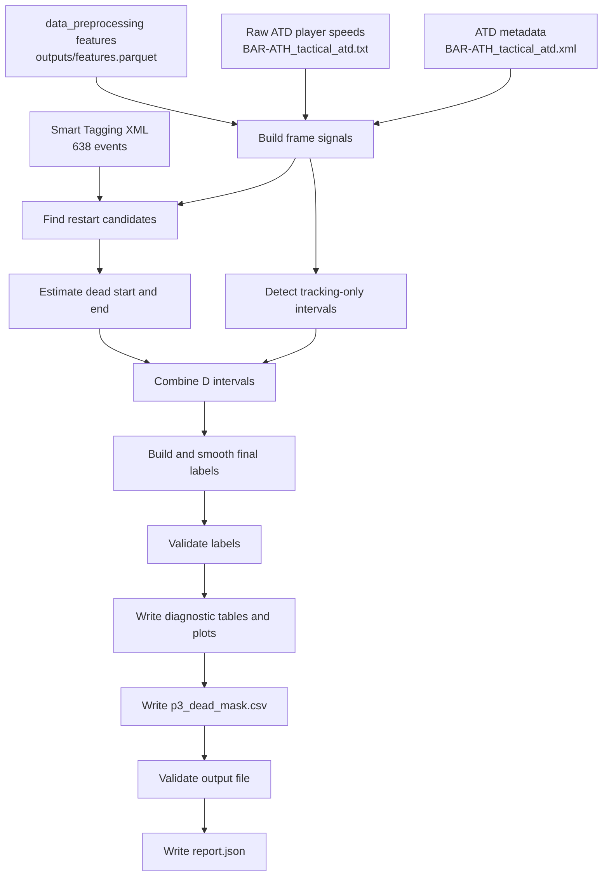

# Dead-ball detection

This document describes the current dead-ball implementation for the BAR-ATH match in the
Barça Possession Challenge. It documents the code as it exists now; it does not describe planned or
hypothetical behaviour.

---

## A. Project Overview

### What dead-ball detection means

A football match contains live-play periods and stoppages. During a stoppage, the ball is not in
play: examples include the interval before a throw-in, corner, free kick, goal kick, kickoff, or the
period between a goal and the following kickoff. The `dead_ball` component identifies those stoppage frames.

The full challenge asks for one label per tactical-video frame:

- `H`: home team in possession, ball alive.
- `A`: away team in possession, ball alive.
- `D`: dead ball, not in play.
- `X`: no answer, or a frame without ground truth.

The `dead_ball` component does **not** decide between `H` and `A`; it produces a
dead-ball mask using `D`, `N`, and `X`:

| Label | `dead_ball` meaning |
|---|---|
| `D` | Dead ball: the frame belongs to a detected stoppage. |
| `N` | Live Play: a graded frame that is not dead. This is an intermediate label, not an error and not a possession decision. The next possession-detection stage resolves it into `H` or `A`. |
| `X` | Ungraded frame. In this implementation `X` is assigned from the input `graded` flag, not from model confidence. |

### Objective of dead-ball detection

Dead-ball detection receives tracking-derived features, raw ATD player-speed information, and automatic Smart
Tagging event hints. It produces a frame-level dead-ball mask and diagnostics that explain why each
dead interval was selected.

The output can be consumed by a downstream possession classifier: `D` frames are stoppages, `N`
frames are Live Play candidates that the next stage resolves into home/away possession, and `X`
frames are outside the graded ranges.

### Why dead-ball identification matters

- Dead-ball errors change possession boundaries. A false `D` can split one possession into two; a
  missed `D` can merge two separate possessions.
- The challenge defines possessions as maximal runs of one team with the ball alive. Stoppages are
  not possessions.
- The ranking metric is possession-spell based, so boundary errors around restarts and goals matter
  more than a few isolated frame errors.
- Dead-ball detection isolates this difficult boundary problem from the later home/away classification task.

### Inputs and outputs

Dead-ball detection reads:

- `outputs/features.parquet`: frame-level ball and cleaned tracking features (falls back to
  `outputs/features.csv.gz` if Parquet support is unavailable).
- `data/tactical/BAR-ATH_tactical_atd.txt`: raw tracking player speeds.
- `data/tactical/BAR-ATH_tactical_atd.xml`: ATD metadata, including the 46 player slots.
- `data/tactical/BAR-ATH_tactical_smart_tagging.xml`: automatic set-piece and goal annotations.
- `games.py`: match constants such as FPS, frame count, pitch size, and half blocks.

It writes:

- `outputs/p3_dead_mask.csv`: the final `frame,label` mask for all 199,319 tactical frames.
- `outputs/dead_mask.csv`: the binary `frame,is_dead` mask consumed by
  `src/possession_estimators` via `--dead`.
- `outputs/p3_diagnostics/`: run summary, diagnostic CSVs, and plots.

The pipeline does not decode the video and does not use the homography CSV.

---

## B. Pipeline Architecture

The build entry point is `src/Dead_Ball/build_p3.py`. Build the feature table first, then run dead-ball detection:

```bash
python -m src.data_preprocessing.build_features --data-dir ./data
python -m src.Dead_Ball.build_p3 \
  --features outputs/features.parquet \
  --raw-atd data/tactical/BAR-ATH_tactical_atd.txt \
  --out outputs/p3_dead_mask.csv \
  --dead-out outputs/dead_mask.csv
```

The feature command must finish successfully before the dead-ball command. If the bundle is outside
`./data`, set `MTAH_DATA_DIR` to its root and update `--data-dir` and `--raw-atd` accordingly;
Smart Tagging is loaded from that bundle using `MTAH_DATA_DIR`.

The workflow is:

1. **Load the `data_preprocessing` feature table** from `outputs/features.parquet` using `load_ball.read_features()`.
2. **Load raw ATD tracking** from `data/tactical/BAR-ATH_tactical_atd.txt` using
   `load_ball.load_player_speeds()`.
3. **Extract player-speed information**. The 46 player slots are read from the ATD XML. For each
   frame, the mean of finite player speeds is kept only when at least eight observations exist.
4. **Load Smart Tagging events** through `load_tagging`, which wraps
   `starter.load_smart_tagging.load()`. Set pieces become restart hints; goals become goal events.
5. **Detect restart candidates**. `rules.compute_activity()` builds ball/player activity signals,
   and `rules.find_restart()` searches for a credible restart near each Smart Tagging set piece.
6. **Estimate dead-ball start frames**. `rules.estimate_dead_start()` searches backwards for the last
   active frame and caps the search using restart-type-specific pre-pads.
7. **Detect tracking-based dead-ball intervals** using missing-ball gaps, out-of-pitch ball runs,
   and stationary-ball windows.
8. **Apply smoothing and post-processing**. Short `D` runs are removed, short gaps are merged under
   conservative conditions, the fixed second-half block is protected, and ungraded frames are reset
   to `X`.
9. **Apply C2_exp10**. C2 seeds slow, isolated ball states, expands only through eligible `N` frames
   for at most 10 seconds per direction, and refuses any promotion that would extend or merge an
   existing `D` run.
10. **Build and validate the final frame-level labels**. The label array is validated in memory. When
    diagnostics are enabled, `validation.write_tables()` and `validation.make_plots()` write the
    diagnostic tables and plots.
11. **Write and validate the outputs, then write the report**. `validation.write_output()` writes
    `outputs/p3_dead_mask.csv`, `validation.write_dead_mask()` writes `outputs/dead_mask.csv`,
    `validation.validate_output_file()` re-reads and validates the mask, and `validation.write_json()`
    writes `report.json` when diagnostics are enabled.



The implementation runs the rule engine twice by default to prove deterministic output. This
reproducibility pass is performed in `build_p3.build()`.

---

## C. Input Data and Data Sources

### Input summary

| Input | Path | Used fields | Why dead-ball detection needs it |
|---|---|---|---|
| `data_preprocessing` features | `outputs/features.parquet` | `frame`, `half`, `graded`, `ball_x`, `ball_y`, `ball_observed`, `ball_valid`, `is_interp`, `is_spike`, `frames_since_ball`, `ball_gap_len`, `ball_speed` | Provides cleaned ball state, speed, gaps, pitch position, and graded ranges. |
| Raw ATD tracking | `data/tactical/BAR-ATH_tactical_atd.txt` | Player slots' third value per slot (speed), line frame id | Provides mean player speed, which is not retained in the feature cache. |
| ATD metadata | `data/tactical/BAR-ATH_tactical_atd.xml` | `Player` entries | Determines that the raw ATD has 46 player slots. |
| Smart Tagging | `data/tactical/BAR-ATH_tactical_smart_tagging.xml` | `code`, `start`, `end`, `Type`, `Team`, `Half` | Provides set-piece hints and goal events. |
| Match constants | `games.py` and `src/Dead_Ball/config.py` | FPS, frame count, pitch, half blocks | Defines the valid frame space and physical distances. |

`outputs/features.parquet` contains additional columns such as `d_home`, `d_away`, `margin`,
`near_team`, `n_home`, and `n_away`. Dead-ball detection does not use those columns.

### `data_preprocessing` feature columns

The feature cache is one row per tactical video frame:

| Column | Meaning used by dead-ball detection |
|---|---|
| `frame` | Video frame, `0..199318`; must be contiguous. |
| `half` | `1` or `2` for play; `0` for ungraded periods. |
| `graded` | Boolean frame-coverage flag. |
| `ball_x`, `ball_y` | Cleaned ball position in metres; `NaN` if no cleaned ball. |
| `ball_observed` | Ball present in raw tracking. |
| `ball_valid` | Cleaned ball available. |
| `is_interp` | Ball position was interpolated. |
| `is_spike` | Raw observation removed as an impossible jump. |
| `frames_since_ball` | Frames since the last cleaned ball observation. |
| `ball_gap_len` | Length of the current missing-ball gap. |
| `ball_speed` | Ball speed in m/s; `NaN` when no ball. |

### Raw ATD format and alignment

Each raw ATD line has the shape:

```text
frame_id:player_slot_1;player_slot_2;...;player_slot_46:ball_group
```

Each player slot is `x,y,speed`. The loader uses the third value in each player slot. It ignores the
ball group after the second colon because the cleaned ball signal comes from the feature file.

The local raw ATD file has sequential frame IDs from `1` through `199319`. Dead-ball detection therefore uses:

```text
video_frame = frame_id - 1
```

The resulting frame index is `0..199318`, matching the submission frame space and the feature file.
The raw-ATD loader requires every one of the 199,319 frame IDs to be present.

`games.py` also defines per-half tracking-counter offsets for the original tracking convention. The
current raw-ATD loader does not use those offsets because the supplied raw file is already sequential
over the tactical video. `config.py` does import and verify the tactical half blocks from `games.py`.

### Smart Tagging timing

Smart Tagging is timed against the tactical video:

```text
video_frame = round(seconds * 25)
```

Intervals are treated as half-open on the right: `start_frame` is included, and `end_frame` is the
first frame after the tagged interval. The project's `check_time_base()` verifies that the real
kickoff frames fall inside the tagged kickoff windows. In the current run it agrees for both halves.

The file contains 638 events. The relevant subset is:

| Smart Tagging category | Count |
|---|---:|
| Throw-in | 26 |
| Corner Kick | 12 |
| Goal Kick | 10 |
| Free Kick | 5 |
| Kick Off (After Goal) | 4 |
| Kick Off (Start) | 2 |
| Total set-piece events | 59 |
| GOALS | 4 |

The Smart Tagging XML is an automatic annotation, not ground truth. Dead-ball detection uses it only to locate
likely restart windows. It does not copy Smart Tagging intervals directly into the output.

### Match constants

The constants are defined in `games.py` and `src/Dead_Ball/config.py`, and are checked by
`config.check_match_constants()`.

| Constant | Value |
|---|---|
| Match | BAR-ATH |
| FPS | 25 |
| Total tactical video frames | 199,319 |
| Pitch size | 105.3 m x 68.0 m |
| First-half graded range | frames `11,185..90,651` |
| Second-half graded range | frames `110,808..190,197` |
| Graded frames | 158,857 |
| Fixed second-half dead block | frames `110,808..113,741` |
| Fixed block length | 2,934 frames (117.36 s) |
| Halftime gap | frames `90,652..110,807` (20,156 frames) |

Frames outside the two graded ranges are assigned `X`.

---

## D. Package Structure

| File | Responsibility |
|---|---|
| `src/Dead_Ball/README.md` | This document. |
| `src/Dead_Ball/__init__.py` | Package marker and exported module names. |
| `src/Dead_Ball/config.py` | Paths, match constants, thresholds, restart profiles, and constant checks. |
| `src/Dead_Ball/load_ball.py` | Reads `data_preprocessing` features and raw-ATD player speeds, and builds the signal dictionary. |
| `src/Dead_Ball/load_tagging.py` | Adapter for the repository Smart Tagging loader; loads events, restarts, goals, and goal-kickoff links. |
| `src/Dead_Ball/rules.py` | Activity detection, restart discovery, dead-start estimation, goal handling, tracking-only intervals, and final label construction. |
| `src/Dead_Ball/smoothing.py` | Removes short `D` islands, merges conservative gaps, and preserves protected frames. |
| `src/Dead_Ball/validation.py` | Validates labels and output files, computes hashes, writes diagnostic tables, and creates plots. |
| `src/Dead_Ball/build_p3.py` | Command-line entry point that orchestrates the full build. |
| `outputs/p3_diagnostics/` | Generated run report, diagnostic CSVs, overview plot, and event plots. |

---

## E. Dead-Ball Detection Logic

### Evidence model: hints versus rules

Smart Tagging is a **hint source**, not a label source:

- A Smart Tagging set piece identifies a window in which a restart probably occurred.
- A Smart Tagging goal identifies a goal event and a likely long stoppage.
- The actual `D` interval is constructed by rule-based activity detection, backward search, goal
  linking, tracking-only detection, and smoothing.

The tagged interval itself is never copied across unchanged.

### Activity signals

`load_ball.build_signals()` computes the signals used by `rules.py`.

A ball speed is **trusted** when all of the following are true:

- The cleaned ball is valid (`ball_valid`).
- The speed is finite.
- The speed is non-negative.
- The speed is at most `BALL_TRUST_MAX_SPEED = 40.0 m/s`.

From trusted ball speed:

- **Ball alive**: trusted ball speed is at least `BALL_ALIVE_SPEED = 5.0 m/s`.
- **Strong ball**: trusted ball speed is at least `BALL_STRONG_SPEED = 12.0 m/s`.

A player is **active** when mean player speed is finite and at least
`PLAYER_ACTIVE_SPEED = 1.6 m/s`.

The rule engine then defines:

```text
combined_activity = ball_alive AND player_active
active            = combined_activity OR strong_ball
```

A combined activity run must last at least `RESTART_COMBINED_MIN_FRAMES = 12` frames. A strong-ball
run must last at least `RESTART_STRONG_BALL_MIN_FRAMES = 2` frames. These run starts become restart
candidates.

### Player speeds from raw ATD

Player speeds are streamed from the raw ATD file in one pass. For each frame:

- The 46 slot speeds are read.
- Non-finite values are ignored.
- The mean of finite values is kept only when there are at least `PLAYER_MIN_OBS = 8` finite
  observations.
- Otherwise the mean player speed is `NaN`, and player activity is not asserted for that frame.

### Restart detection

`rules.find_restart()` searches for the first credible restart associated with each tagged set piece.

For a normal set piece:

- The search starts at the tag's `start_frame`, clipped to the current half.
- The search ends at `tag_end + post_search_s`.
- A candidate is considered only if the number of immediately preceding inactive frames is at least
  `RESTART_MIN_STOPPAGE_FRAMES = 50` frames, equivalent to 2.0 seconds.
- The first accepted combined or strong run start becomes the restart frame.

For `KICKOFF_START`, the search is special:

- First half: the search starts at the first-half start.
- Second half: the search starts at `FIXED_DEAD_END + 1`.
- No 2-second preceding-inactivity requirement is applied.
- The search still ends at `tag_end + post_search_s`.

If no candidate is found, the implementation has a fallback:

- For `KICKOFF_START`, use the relevant half start, or the fixed second-half block end plus one.
- For other set pieces, use `min(tag_end, half_end)`.

Fallbacks are recorded in diagnostics as `fallback=true`. The current run reports 59 restart rows
with 0 fallbacks.

### Restart types and search profiles

The restart type comes from the Smart Tagging `Type` tag and is mapped in
`config.RESTART_TYPE_MAP`:

| Restart type | `pre_pad_s` | `post_search_s` | Source |
|---|---:|---:|---|
| `THROW_IN` | 6.0 s | 20.0 s | `config.RESTART_PROFILES` |
| `CORNER` | 8.0 s | 15.0 s | `config.RESTART_PROFILES` |
| `GOAL_KICK` | 6.0 s | 20.0 s | `config.RESTART_PROFILES` |
| `FREE_KICK` | 10.0 s | 20.0 s | `config.RESTART_PROFILES` |
| `KICKOFF_START` | 0.0 s | 5.0 s | `config.RESTART_PROFILES` |
| `KICKOFF_AFTER_GOAL` | 0.0 s | 25.0 s | `config.RESTART_PROFILES` |

The profiles also contain a `pre_search_s` field, but the current rule implementation does not
reference it.

### Dead-start estimation

After finding a restart frame, `rules.estimate_dead_start()` determines where the dead interval
begins:

```text
pad_low     = max(half_start, tag_start - round(pre_pad_s * 25))
search_high = restart_frame - RESTART_MIN_STOPPAGE_FRAMES
search_low  = max(half_start, restart_frame - RESTART_BACKTRACK_MAX_FRAMES)
```

The engine finds the last active frame in `[search_low, search_high]`.

- If an active frame exists, `dead_start = max(pad_low, last_active + 1)`.
- If no active frame exists in the search window, `dead_start = pad_low`.
- `dead_end = restart_frame - 1`.

The pre-pad prevents a long missing-ball gap from an earlier phase from stretching one set-piece
interval across the entire gap. The rule path uses `RESTART_BACKTRACK_MAX_FRAMES`, derived from
`RESTART_BACKTRACK_MAX_S = 60.0 s` at 25 FPS, so the backward search covers at most 1,500 frames.
`MAX_BACKWARD_SEARCH_S` is also 60.0 s and is written to the report threshold block, but
`rules.estimate_dead_start()` does not read it; the derived `MAX_BACKWARD_SEARCH_FRAMES` constant is
currently unused.

For `KICKOFF_START`, the interval is forced to start at the relevant half start:

- First half: `11,185`.
- Second half: `110,808`.

The interval ends at `restart_frame - 1`.

All event intervals are clipped to their half range. Overlapping intervals are merged, but gaps are
not filled at this stage (merge gap is zero here).

### Goal and kickoff handling

Goals are loaded from Smart Tagging code `GOALS`. For each goal:

1. Find the first `KICKOFF_AFTER_GOAL` whose `start_frame` is at or after the goal start and no more
   than 60 seconds after the goal end. This 60-second window is hard-coded in
   `load_tagging.link_goals_to_kickoffs()`.
2. If a kickoff is linked, the goal's dead interval ends at `kickoff_restart_frame - 1`.
3. If no kickoff is linked, the goal's dead interval ends at `goal_end_frame - 1`.
4. Apply `GOAL_PRE_PAD_S = 0.0 s` and `GOAL_END_PAD_S = 0.0 s`. These pads are configurable, but
   both are currently zero.
5. Skip the separately tagged `KICKOFF_AFTER_GOAL` interval when it is already part of a goal
   interval, avoiding duplicate goal/kickoff diagnostics.

The goal interval is therefore a long stoppage from the goal through the following restart. It can
include celebrations and restart setup.

### Tracking-only detection

`rules.detect_tracking_intervals()` adds dead intervals that do not require a Smart Tagging restart.
It implements three rules.

#### Missing-ball gaps

Frames qualify when:

- The frame is graded.
- The cleaned ball is unavailable.
- `ball_gap_len >= 75` frames (3.0 s).

For each contiguous qualifying run:

- At least `max(3, 25% of run length)` finite player-speed observations must exist.
- Mean player speed must be below `1.0 m/s`.

If both conditions hold, the entire gap is marked `D` with source `low_activity_gap`.

#### Out-of-pitch ball

A frame is out of pitch when the cleaned ball position is valid and:

```text
ball_x < -1.0 m
OR ball_x > 106.3 m
OR ball_y < -1.0 m
OR ball_y > 69.0 m
```

These bounds use the pitch size plus `PITCH_TOLERANCE_M = 1.0 m`.

For each raw out-of-pitch run:

- The run must last at least `OOP_MIN_FRAMES = 38` frames (1.5 s).
- Expand the run by `OOP_PAD_FRAMES = 25` frames (1.0 s) on each side.
- Clip the expanded run to the half.
- Mark the expanded run as `D` if at least one of these is true:
  - Mean finite player speed is below `1.5 m/s`.
  - The raw run is at least twice the minimum length (`76` frames).
  - The raw length divided by expanded length is at least `0.5`.

The source is recorded as `out_of_pitch`.

#### Stationary visible ball

A centered 250-frame (10.0 s) rolling window is used:

- Ball speed is considered only when trusted; otherwise it is `NaN`.
- The ball-speed and player-speed rolling means require at least 200 observations.
- The valid-fraction and strong-fraction rolling means use a full 250-frame window.
- Ball valid fraction must be at least `0.9`.
- The strong-ball fraction must be below `1e-9` (effectively zero).
- Mean ball speed must be below `2.5 m/s`.
- Mean player speed must be below `1.5 m/s`.

Qualifying windows are merged across gaps of at most 25 frames (1.0 s). The resulting interval must
last at least 200 frames (8.0 s). The source is recorded as `stationary_ball`.

### Threshold reference

| Threshold | Value | Unit | Controls | Defined in |
|---|---:|---|---|---|
| `BALL_TRUST_MAX_SPEED` | 40.0 | m/s | Maximum trusted ball speed. | `config.py` |
| `PITCH_TOLERANCE_M` | 1.0 | m | Out-of-pitch tolerance beyond the pitch lines. | `config.py` |
| `BALL_ALIVE_SPEED` | 5.0 | m/s | Ball-alive activity threshold. | `config.py` |
| `BALL_STRONG_SPEED` | 12.0 | m/s | Strong-ball activity threshold. | `config.py` |
| `PLAYER_ACTIVE_SPEED` | 1.6 | m/s | Player-active threshold. | `config.py` |
| `PLAYER_MIN_OBS` | 8 | observations | Minimum finite player speeds for a frame mean. | `config.py` |
| `RESTART_COMBINED_MIN_FRAMES` | 12 | frames | Minimum combined activity run. | `config.py` |
| `RESTART_STRONG_BALL_MIN_FRAMES` | 2 | frames | Minimum strong-ball run. | `config.py` |
| `RESTART_MIN_STOPPAGE_S` | 2.0 | s | Required inactivity before a non-kickoff restart. | `config.py` |
| `RESTART_BACKTRACK_MAX_S` | 60.0 | s | Maximum dead-start backtrack used by `rules.estimate_dead_start()`. | `config.py` |
| `MAX_BACKWARD_SEARCH_S` | 60.0 | s | Report-only threshold value; not used by the current rule path. | `config.py` |
| `MIN_D_RUN_S` | 2.0 | s | Remove D runs shorter than this. | `config.py` |
| `MERGE_GAP_S` | 2.0 | s | Merge eligible D gaps up to this length. | `config.py` |
| `GAP_MIN_S` | 3.0 | s | Minimum missing-ball gap. | `config.py` |
| `GAP_MAX_MEAN_PLAYER_SPEED` | 1.0 | m/s | Maximum mean player speed for a low-activity gap. | `config.py` |
| `OOP_MIN_S` | 1.5 | s | Minimum raw out-of-pitch run. | `config.py` |
| `OOP_PAD_S` | 1.0 | s | Out-of-pitch expansion on each side. | `config.py` |
| `OOP_MAX_MEAN_PLAYER_SPEED` | 1.5 | m/s | Maximum mean player speed for out-of-pitch low activity. | `config.py` |
| `OOP_MIN_FRACTION` | 0.5 | fraction | Minimum out-of-pitch fraction after padding. | `config.py` |
| `STATIONARY_WINDOW_S` | 10.0 | s | Stationary-ball rolling window. | `config.py` |
| `STATIONARY_MAX_BALL_SPEED` | 2.5 | m/s | Maximum mean ball speed for stationary ball. | `config.py` |
| `STATIONARY_MAX_PLAYER_SPEED` | 1.5 | m/s | Maximum mean player speed for stationary ball. | `config.py` |
| `STATIONARY_MIN_VALID_FRACTION` | 0.9 | fraction | Minimum valid-ball coverage in the window. | `config.py` |
| Strong-ball fraction ceiling | 1e-9 | fraction | Reject stationary windows containing strong-ball evidence. | `rules.py` |
| `STATIONARY_MIN_DURATION_S` | 8.0 | s | Minimum stationary interval. | `config.py` |
| `STATIONARY_MERGE_GAP_S` | 1.0 | s | Merge stationary-mask runs across this gap. | `config.py` |
| `GOAL_PRE_PAD_S` | 0.0 | s | Extra time before a goal interval. | `config.py` |
| `GOAL_END_PAD_S` | 0.0 | s | Extra time after a goal interval. | `config.py` |
| Goal-to-kickoff link window | 60.0 | s | Maximum time from goal end to a following kickoff. | `load_tagging.py` |
| Low-activity-gap observation floor | `max(3, 25% of run)` | observations | Minimum finite player-speed samples in a gap. | `rules.py` |
| Stationary rolling minimum | 200 of 250 | frames | Minimum observations for stationary rolling means. | `rules.py` |
| Smoothing merge iterations | 20 | iterations | Maximum merge pass count. | `smoothing.py` |

Implementation note: `config.py` also defines `PLAYER_DEAD_SPEED`, `PLAYER_OOP_MAX_SPEED`, and
`MAX_BACKWARD_SEARCH_FRAMES`, but the current rule path does not reference them.
`MAX_BACKWARD_SEARCH_S` is included in `report.json` under `config.thresholds`, but the rule path
uses `RESTART_BACKTRACK_MAX_S` through `RESTART_BACKTRACK_MAX_FRAMES`.

---

## F. Smoothing and Post-processing

Smoothing is implemented in `src/Dead_Ball/smoothing.py`.

### Removal of short dead-ball intervals

Every `D` run shorter than `MIN_D_RUN_FRAMES = 50` frames (2.0 s) is changed to `N`, unless any frame
in the run is protected. The only protected region in the current implementation is the fixed
second-half block.

Current run: 1 short run was removed.

### Merging short gaps

The smoother examines adjacent `D` runs. A gap between them is filled with `D` only when all of the
following are true:

- The gap is at most `MERGE_GAP_FRAMES = 50` frames (2.0 s).
- The gap lies entirely within one graded half range.
- There is no strong-ball evidence in the gap.
- There is no active run of at least `RESTART_COMBINED_MIN_FRAMES = 12` frames in the gap. Here
  `active` means combined activity or strong-ball activity.

The merge loop runs up to 20 iterations and stops early when no further merge occurs.

Current run: 4 gaps were merged.

### Fixed second-half block

The block `110808..113741` is always protected:

- It is excluded from short-run removal.
- It is restored to `D` after smoothing.
- Its length is checked to be exactly 2,934 frames.

### Ungraded frames

After smoothing:

- The protected block is forced back to `D`.
- Every frame where `features["graded"]` is false is forced to `X`.

This means `X` is not generated by confidence thresholds; it comes from the input graded mask.

---

## G. Output Files

### `outputs/p3_dead_mask.csv`

The primary output. It has exactly two columns and 199,319 rows:

```csv
frame,label
0,X
1,X
11185,N
110808,D
113741,D
199318,X
```

The example above is illustrative and truncated; it is not a contiguous excerpt.

- `frame`: integer video frame, `0..199318`.
- `label`: one of `D`, `N`, or `X`.

This file is an intermediate dead-ball mask, not a complete challenge submission. `N` means Live Play
(not dead) and is an intermediate label, not an error or missing answer. The next possession-detection
stage resolves each `N` frame into `H` or `A`.

### `outputs/dead_mask.csv`

The binary mask consumed by `src/possession_estimators` through `--dead outputs/dead_mask.csv`. It has exactly two columns and
199,319 rows:

```csv
frame,is_dead
0,False
1,False
11185,False
110808,True
199318,False
```

`is_dead` is `True` exactly where `p3_dead_mask.csv` has label `D`.

### `outputs/p3_diagnostics/report.json`

A machine-readable summary containing:

| Key | Contents |
|---|---|
| `config` | FPS, frame count, pitch, graded ranges, fixed block, selected thresholds. |
| `smart_tagging` | Event counts, restart counts, Smart Tagging counts, time-base check. |
| `restarts` | Per-restart-type counts, accepted/fallback counts, delay statistics. |
| `goals` | Goal count, linked kickoff count, goal D-frame count, goal durations. |
| `tracking` | Tracking-only interval counts and frame totals by source. |
| `final` | Final label counts, smoothing statistics, final D-run count. |
| `validation` | In-memory label validation and output-file validation results. |
| `reproducibility` | Deterministic rebuild flag, label hash, output SHA-256. |
| `diagnostics` | Diagnostic plot metadata. |
| `output` | Path to the written mask. |

### `restart_diagnostics.csv`

One row per restart candidate. Current run: 59 rows.

Columns:

`event_id`, `restart_type`, `team`, `half`, `tag_start`, `tag_end`, `restart_frame`, `delay_s`,
`accepted`, `fallback`, `evidence`, `candidate_count`, `dead_start`, `dead_end`,
`dead_duration_s`, `last_active_frame`, `backtrack_used`.

### `goal_diagnostics.csv`

One row per goal interval. Current run: 4 rows.

Columns:

`start`, `end`, `source`, `restart_type`, `event_id`, `team`, `kickoff_event_id`, `cluster`,
`restart_frame`, `evidence`, `fallback`, `duration_s`.

### `tracking_diagnostics.csv`

One row per tracking-only interval. Current run: 62 rows.

Columns:

`start`, `end`, `source`, `duration_s`, `mean_player_speed`, `player_speed_count`, `evidence`,
`out_of_pitch_fraction`, `mean_ball_speed`.

The `source` values are `low_activity_gap`, `out_of_pitch`, and `stationary_ball`. Not every column is
populated for every source.

Example, with a header only:

```csv
start,end,source,duration_s,mean_player_speed,player_speed_count,evidence,out_of_pitch_fraction,mean_ball_speed
```

### `final_d_runs.csv`

One row per final `D` interval after smoothing and C2. Current run: 83 rows.

Columns:

`start_frame`, `end_frame`, `duration_s`, `start_s`, `end_s`.

Example:

```csv
start_frame,end_frame,duration_s,start_s,end_s
17453,17872,16.8,698.12,714.88
```

This is an illustrative example taken from the current diagnostics head.

### `overview.png`

A three-panel overview of the full match:

1. Trusted ball speed and mean player speed, with `D` shaded.
2. Ball `x` and `y` position, with `D` shaded.
3. Final `D` mask over tactical-video minutes.

### Event diagnostic plots

The build writes `event_<name>_<id>.png` plots for selected cases:

- One accepted example for each restart type that occurs.
- One second-half `KICKOFF_START` plot.
- The longest goal interval.
- One representative interval for each tracking source:
  - the low-activity gap closest to the median gap duration,
  - the longest out-of-pitch interval,
  - the longest stationary-ball interval.

The current run generated 11 event plots plus `overview.png`.

---

## H. Validation and Reproducibility

### Enforced checks

These checks raise an error during the build:

| Check | Implemented by | Failure behaviour |
|---|---|---|
| Match constants agree with `games.py` half blocks. | `config.check_match_constants()` | Raises `AssertionError`. |
| Expected total frame count is 199,319. | `config.check_match_constants()` | Raises `AssertionError`. |
| Fixed block is exactly 2,934 frames. | `config.check_match_constants()` | Raises `AssertionError`. |
| Feature file has required columns. | `load_ball.read_features()` | Raises `ValueError`. |
| Feature file has 199,319 rows. | `load_ball.read_features()` | Raises `ValueError`. |
| Feature frame column is exactly `0..199318` in order. | `load_ball.read_features()` | Raises `ValueError`. |
| Raw ATD has every expected frame ID. | `load_ball.load_player_speeds()` | Raises `ValueError` naming the number of missing IDs. |
| Label array length is correct. | `validation.validate_labels()` | Build raises `RuntimeError`. |
| Labels are strings and only `D`, `N`, `X`. | `validation.validate_labels()` | Build raises `RuntimeError`. |
| Non-graded frames are all `X`. | `validation.validate_labels()` | Build raises `RuntimeError`. |
| Graded frames are all `D` or `N`. | `validation.validate_labels()` | Build raises `RuntimeError`. |
| Fixed block contains only `D` and has the exact length. | `validation.validate_labels()` | Build raises `RuntimeError`. |
| At least one `D` and one `N` exist. | `validation.validate_labels()` | Build raises `RuntimeError`. |
| Output header is exactly `frame,label`. | `validation.validate_output_file()` | Build raises `RuntimeError`. |
| Output has 199,319 rows. | `validation.validate_output_file()` | Build raises `RuntimeError`. |
| Output frame column is exactly `0..199318` in order. | `validation.validate_output_file()` | Build raises `RuntimeError`. |
| Output labels are allowed values and pass label validation. | `validation.validate_output_file()` | Build raises `RuntimeError`. |
| Rule engine is deterministic. | `build_p3.build()` with default reproducibility check | Runs the engine twice and raises `RuntimeError` if arrays differ. |

The exact output frame-sequence check also prevents duplicate and missing output frames.

### Duplicate and missing input frames

- Feature input: the exact `frame == 0..199318` check rejects duplicate or missing frames.
- Raw ATD input: the loader checks that every expected frame index was seen. It does not separately
  reject duplicate raw lines.
- Output: the exact frame-sequence check rejects duplicate or missing output frames.

### Recorded but not enforced

These are written to diagnostics but do not abort the run in the current implementation:

- Smart Tagging time-base agreement. `build_p3` records the result but does not raise when
  `agrees` is false.
- Restart acceptance and fallback counts.
- Goal-to-kickoff link counts.
- Diagnostic interval counts.
- Label and output SHA-256 hashes.

The current run reports 59 restart rows, all accepted, 0 fallbacks, and 4 linked goals. There is no
separate hard assertion that requires those counts; they are diagnostic observations.

### Reproducibility

By default, `build_p3.build()` runs `rules.build_label_array()` twice and compares the two label
arrays. It records:

- `deterministic_rebuild: true`
- Label-array SHA-256
- Output-file SHA-256

The current output hash is:

```text
088c1280c16db06e7301b285e1f155367b72a01e242e5b7833387fe8fb6ef5ef
```

`--no-repro-check` skips the double-run comparison but still computes the hashes.

---

## I. How to Run the dead_ball component

### Required environment

The repository documentation requires Python 3.8 or newer. The verified local environment for this
project is:

- Python 3.13.14 in `offsidenv`
- numpy 2.5.4
- pandas 3.1.1
- matplotlib 3.11.2

The core pipeline needs `numpy` and `pandas`. `matplotlib` is required for the default diagnostic
plots (`overview.png` and the event plots). It is not needed for the mask itself; use
`--no-diagnostics` when plots are not needed. The Smart Tagging and ATD XML readers use the Python
standard library.

The commands below use `python` and assume the project environment is active. If using the provided
Windows environment, activate it from the repository root with
`.\offsidenv\Scripts\Activate.ps1`; otherwise use the equivalent activation command for your
environment.

Install the core dependencies from the repository root:

```powershell
python -m pip install -r requirements.txt
```

Install matplotlib to run the default build with diagnostic plots:

```powershell
python -m pip install matplotlib
```

### Run from the repository root

From the repository root with the project environment active. Run the
`data_preprocessing` command first to generate `outputs/features.parquet`:

```powershell
python -m src.Dead_Ball.build_p3 --features outputs/features.parquet --raw-atd data/tactical/BAR-ATH_tactical_atd.txt --out outputs/p3_dead_mask.csv --dead-out outputs/dead_mask.csv
```

If using the provided Windows environment, activate it from the repository root first:

```powershell
.\offsidenv\Scripts\Activate.ps1
python -m src.Dead_Ball.build_p3
```

The module entry point must be run from the repository root so that `src.Dead_Ball`, `starter`, and
`games.py` are importable. Running `python src/Dead_Ball/build_p3.py` directly is not the documented
entry point because the package uses relative imports.

### Command-line options

Verified with `-m src.Dead_Ball.build_p3 --help`:

```text
--features FEATURES    Override the data_preprocessing feature-table path.
--raw-atd RAW_ATD      Override the raw ATD text path.
--out OUT              Override the frame,label mask output path.
--dead-out DEAD_OUT    Override the binary frame,is_dead mask path.
--no-diagnostics       Do not write diagnostic tables, plots, or report.json.
--no-repro-check       Skip the double-run determinism comparison.
```

Example with explicit paths (also specify `--dead-out` to write the mask used by possession estimation):

```powershell
python -m src.Dead_Ball.build_p3 `
  --features outputs\features.parquet `
  --raw-atd data\tactical\BAR-ATH_tactical_atd.txt `
  --out outputs\p3_dead_mask.csv `
  --dead-out outputs\dead_mask.csv
```

Running the build rewrites `outputs/p3_dead_mask.csv` and the diagnostics directory. Do not run it
when the existing generated outputs must remain unchanged.

### Expected output files

After a successful run:

- `outputs/p3_dead_mask.csv`
- `outputs/dead_mask.csv`
- `outputs/p3_diagnostics/report.json`
- `outputs/p3_diagnostics/restart_diagnostics.csv`
- `outputs/p3_diagnostics/goal_diagnostics.csv`
- `outputs/p3_diagnostics/tracking_diagnostics.csv`
- `outputs/p3_diagnostics/final_d_runs.csv`
- `outputs/p3_diagnostics/overview.png`
- selected `outputs/p3_diagnostics/event_*.png` plots

### Inspecting diagnostics

Open the JSON report:

```powershell
Get-Content outputs\p3_diagnostics\report.json
```

Open the overview plot:

```powershell
Invoke-Item outputs\p3_diagnostics\overview.png
```

Review the restart, goal, tracking, and final-run tables with any CSV viewer or Python/pandas.

---

## J. Current Results

The following values are confirmed by both the generated output and
`outputs/p3_diagnostics/report.json`.

| Metric | Value |
|---|---:|
| Total frames | 199,319 |
| `D` frames | 55,211 (27.7%) |
| `N` frames | 103,646 (52.0%) |
| `X` frames | 40,462 (20.3%) |
| Graded frames | 158,857 |
| Final `D` intervals | 83 |
| Minimum `D` duration | 2.00 s |
| Median `D` duration | 14.12 s |
| Mean `D` duration | 26.61 s |
| Maximum `D` duration | 255.64 s |
| Fixed second-half block | 2,934 frames |
| Deterministic rebuild | Passed |
| Output SHA-256 | `088c1280c16db06e7301b285e1f155367b72a01e242e5b7833387fe8fb6ef5ef` |

Additional verified diagnostics:

| Diagnostic | Value |
|---|---:|
| Restart candidates | 59 |
| Accepted restarts | 59 |
| Restart fallbacks | 0 |
| Goals | 4 |
| Goals linked to kickoffs | 4 |
| D frames reported from goal intervals | 17,167 |
| Low-activity-gap intervals | 40 |
| Low-activity-gap frames | 28,317 |
| Out-of-pitch intervals | 19 |
| Out-of-pitch frames | 2,907 |
| Stationary-ball intervals | 3 |
| Stationary-ball frames | 1,159 |
| Short D runs removed | 1 |
| D gaps merged | 4 |
| C2 promoted `N` to `D` | 886 |
| C2 new intervals | 3 |
| C2 existing D runs extended | 0 |
| C2 existing D runs merged | 0 |
| C2 guard passed | Yes |

The C2 intervals are `15,917..16,320` (404 frames), `78,688..78,922` (235 frames), and
`131,184..131,430` (247 frames). The report also lists two seed runs that did not become promoted
intervals: `84,846..85,026` and `105,457..105,743`.

The tracking and goal frame totals above are diagnostic interval contributions before overlapping
intervals are combined into the final mask.

### Public 5-minute ground-truth proxy

A read-only check was run against `evaluation/gt/BAR-ATH_possession_gt_public.csv` on the public
window `11,185..18,684` (7,500 frames, the first 5 minutes of play). Dead-ball `D` was compared with
ground-truth `D`; dead-ball `N` was treated as Live Play. This is a dead-ball-only proxy, not the
official challenge score and not a full-match evaluation.

| Metric | Value |
|---|---:|
| Precision | 0.9142 |
| Recall | 0.7835 |
| F1-score | 0.8438 |
| Ground-truth dead-ball spells | 4 |
| Missed dead-ball spells | 1 |

The missed ground-truth dead-ball run is `12,851..15,888`. The metrics describe the current C2 mask;
they do not measure home/away possession accuracy and do not cover the rest of the match. Thresholds
were not tuned using this proxy check.

---

## K. Limitations and Future Improvements

### Current limitations

- Thresholds are physical or operational choices. They were not fitted using public ground truth.
- Smart Tagging is automatic and may contain false positives and false negatives. Dead-ball detection reduces
  this risk by using tags as hints rather than copying tagged intervals.
- Untagged stoppages can be missed, especially when the ball remains visible, moves slowly, and
  player movement is moderate.
- On the public 5-minute proxy window, dead-ball precision is 0.874, recall is 0.509, and F1 is
  0.643; two of four ground-truth dead-ball spells were missed. This is not a full-match result.
- Tracking quality affects every rule: missing ball observations, noisy speeds, identity switches,
  and pitch-coordinate outliers can change detected intervals.
- Goal intervals intentionally extend from the goal until the following kickoff, so they include
  celebrations and restart setup rather than only the instant of the goal.
- The fixed second-half block is a hard-coded match constant and is protected from smoothing.
- A public 5-minute proxy check has been run, but no full-match manual semantic audit of every `D`
  interval has been completed. The diagnostics are intended to support such an audit.
- There is no hard validation that all restart candidates must be accepted or that every goal must
  be linked; those are reported, not enforced.
- The current implementation is configured for BAR-ATH and expects the local sequential raw-ATD
  frame convention.

### Possible future improvements

These are not implemented in the current code:

- Add a manual review workflow for diagnostics, focusing on long goal intervals, low-activity gaps,
  and stationary-ball detections.
- Improve ball-gap handling using additional tracking or phase context.
- Add explicit validation or warning thresholds for restart fallback rates and unlinked goals.
- Use homography or player geometry as additional restart evidence.
- Add unit tests around half boundaries, the fixed block, fallback restart behavior, goal linking,
  and smoothing edge cases.
- Generalise the raw-ATD adapter to support other frame-counter conventions if additional matches are
  added.
- Add confidence or uncertainty output for downstream selection between `N` and `X`.
- Evaluate the mask against additional matches or a permitted validation set, without using hand
  labels from the provided match for training.

---

## L. Troubleshooting

### Missing input files

Symptoms include `FileNotFoundError` for `outputs/features.parquet` (or its CSV fallback) or the raw ATD file, or an
`IOError` from the Smart Tagging loader saying `match data not found`.

Check that these files exist from the repository root:

- `outputs/features.parquet` (or `outputs/features.csv.gz` when Parquet support is unavailable)
- `data/tactical/BAR-ATH_tactical_atd.txt`
- `data/tactical/BAR-ATH_tactical_atd.xml`
- `data/tactical/BAR-ATH_tactical_smart_tagging.xml`

The Smart Tagging loader can use the `MTAH_DATA_DIR` environment variable if the data bundle is stored
elsewhere. The dead-ball feature and raw-ATD paths come from `src/Dead_Ball/config.py`.

### Import errors

If Python reports `No module named 'src.Dead_Ball'` or `No module named 'starter'`, the command was
probably run outside the repository root.

From the repository root with the project environment active, run:

```powershell
python -m src.Dead_Ball.build_p3
```

If `config.py` reports `games.py not found above ...`, the package is being imported from an
incomplete copy of the repository. Keep `games.py` at the repository root.

### Incorrect working directory

The module entry point resolves paths relative to the repository root and expects `games.py` above
the package directory. Running from another directory can break both imports and default input paths.
Change to the repository root before running the module.

### Missing Python dependencies

If `numpy` or `pandas` is missing:

```powershell
python -m pip install -r requirements.txt
```

If diagnostics fail because `matplotlib` is missing:

```powershell
python -m pip install matplotlib
```

or run without diagnostics:

```powershell
python -m src.Dead_Ball.build_p3 --no-diagnostics
```

With `--no-diagnostics`, the mask is still written, but `report.json`, diagnostic tables, and plots
are not generated.

### Frame alignment problems

- Feature error `features frame column is not 0..199318 in order`: regenerate or verify
  `outputs/features.parquet` (or its CSV fallback).
- Raw ATD error `raw ATD is missing N frame ids`: the raw file does not cover all 199,319 frames
  using IDs `1..199319`.
- The raw-ATD adapter maps `video_frame = frame_id - 1`. Do not add a tracking-counter offset to this
  file unless the input file actually uses that different convention.
- Smart Tagging frames are `round(seconds * 25)`. If the XML clock changes, inspect
  `report.json` under `smart_tagging.time_base` rather than applying an arbitrary offset.

### Output validation failures

If the build raises `label validation failed` or `output validation failed`, inspect the error list in
the exception or in `report.json` under `validation`.

Common causes include:

- A row count other than 199,319.
- A frame column that is not contiguous.
- A label other than `D`, `N`, or `X`.
- A non-graded frame that is not `X`.
- A fixed block frame that is not `D`.
- A missing or extra CSV column.

Fix the input or the generated file by rerunning the pipeline; do not hand-edit the mask to bypass
validation.

### Smart Tagging time-base mismatch

If `report.json` shows `"agrees": false` under `smart_tagging.time_base`, the Smart Tagging export is
on a different clock than the tactical video. The build still reports the result but does not fail.
Investigate the source export; do not silently add a constant offset.

### Destructive reruns

`build_p3` overwrites `outputs/p3_dead_mask.csv` and the diagnostics directory. Copy or commit any
result that must be preserved before running the build again.
